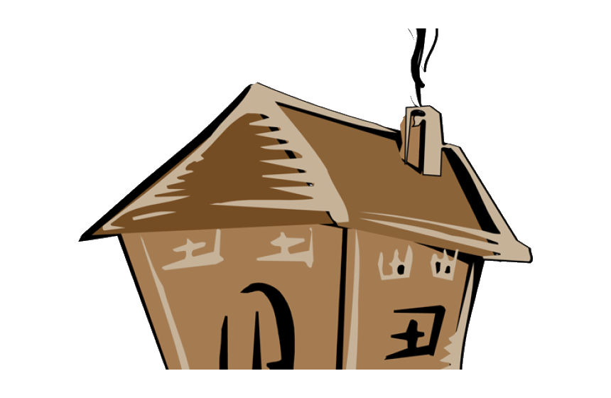

[](https://github.com/gongahkia/shack/actions/workflows/ci.yml)

# `Shack` - a SHiok Atomweight Cli worKstation

Shack is an [atomweight](https://en.wikipedia.org/wiki/Atomweight) terminal IDE with [sensible day 1 defaults](https://martinfowler.com/bliki/SensibleDefault.html).

<div align="center">
    
</div>

## Stack

* *Scripting*: [Go 1.27+](https://go.dev/dl/)
* *CLI*:[tcell](https://github.com/gdamore/tcell)
* *Highlighting*: [Chroma](https://github.com/alecthomas/chroma)

## Features

* Familiar keyboard shortcuts and mouse selection
* Multiple buffers, split panes, a project file tree and an optional minimap
* Literal and regex search, multiple selections and reviewed multi-file replacements
* Bundled syntax highlighting, with optional language servers for completion, diagnostics, navigation and formatting
* Markdown and Org reading views, live previews and code folding
* Integrated terminals, build/test tasks, Git tools and optional source-level debugging
* Unsaved-buffer recovery, project sessions and [JSON configuration](./docs/USAGE.md#configuration)

## Usage

> [!IMPORTANT]
> Building from source requires Go 1.27 or newer and `make`. 

### Building `Shack` yourself

1. Clone the repository.

```console
$ git clone https://github.com/gongahkia/shack && cd shack
```

2. Build and open the project in your terminal.

```console
$ GOTOOLCHAIN=auto make build
$ ./build/shack .
```

3. Then run the below to open a specific file

```console
$ ./build/shack docs/USAGE.md
```


4. Optionally edit a file without a language server using the below.

```console
$ ./build/shack --no-lsp .
```

5. See the [usage guide](./docs/USAGE.md) for the full list of controls, configuration, and [language-server workflows](./docs/LANGUAGE_SERVERS.md).

## Reference

Also see [`Shed`](https://github.com/gongahkia/shed).
