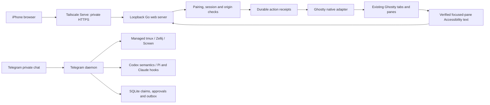

# Product and engineering audit

Audit date: 2026-10-23. Baseline: `928fb1b8`. This review covered the Go CLI, daemon, Telegram transport, agent hooks, persistence, terminal backends, native service integration, rendering, credential storage, tests, and GitHub workflows.

## Intended product

**Control Ghostty wherever text renders.** The maintainer clarified that this means controlling the exact Ghostty tabs and windows already open on the Mac from an iPhone. Merely attaching two clients to an Onibi-created multiplexer session does not satisfy that goal.

The original README described a narrower Telegram-only product and explicitly excluded Ghostty and browser access. The code matched that narrower description reasonably well, so the largest gap was a product-direction mismatch, not a missing decorative UI. The agreed first expansion is a Mac-served mobile web interface over private Tailscale HTTPS, including existing-pane selection, bounded output, literal input, keys, tab creation, and confirmed tab closure. Telegram remains available for its existing managed sessions and agent interactions.

## Principles mapped to implementation

| Principle | Baseline implementation | Gap and action in this pass |
| --- | --- | --- |
| Continue work where it already exists | `internal/mux` manages/adopts tmux, Zellij and Screen; Codex is a separate semantic process | No Ghostty identity or control. Added `internal/ghostty` for native window/tab/pane identities and direct actions. |
| Reach the Mac from a phone | Telegram private chat only; daemon startup requires a bot token | Added independent `onibi web`, embedded phone interface, and explicit private HTTPS origin. Telegram credentials are optional for this path. |
| Make the destination clear | Persistent selected Telegram session; buttons carry local opaque tokens | Kill confirmation was not bound to a session. Fixed it. Web input requires a selected native target and never substitutes the foreground terminal. |
| Preserve literal user intent | Telegram sends text plus Enter; `/paste` promises exact text without Enter | Slash commands intercepted paste mode; whitespace was rejected; Zellij parsed leading dashes. Fixed these paths and Unicode truncation. Web separates Send from Paste. |
| Require explicit authority | Private-chat/user checks, local same-user socket, high-risk approval confirmation | Pairing code could replace an owner before restart; partial storage failures were ignored. Pairing is now transactional and single-use. Browser pairing adds its own expiring session and CSRF/origin checks. |
| Do not repeat uncertain commands | Telegram claims updates before side effects and reports unfinished claims after restart | Added the same principle to web action receipts. A network failure checks the saved receipt instead of repeating input. |
| Show honest, bounded feedback | Screenshot/text limits, queued notices, health status | Concurrent outbox replacement could lose newer output; 500ms scheduling rounded to seconds; health mislabeled backends. Fixed all three. Web distinguishes a fresh snapshot from unavailable or stale output. |
| Decisions exist only while useful | Pending approvals/questions expire and resolve idempotently | Disconnected hooks left actionable decisions; question cancellation could deadlock; Codex shutdown could race its reader. Fixed cancellation, database cursor lifetime and reader shutdown ordering. |
| Keep terminal data local unless deliberately sent | Private local state, bounded uploads, redacted logs, Telegram delivery | Credential writes could ignore read failures; backend errors printed complete input arguments; short downloads appeared successful. Fixed storage, error formatting and upload integrity. Web uses embedded assets and stores receipt hashes rather than input bodies. |
| Make verification reproducible | Hermetic Go suite on macOS/Linux; separate live Telegram test | Baseline macOS CI failed on canonical path assumptions, and the pinned Go toolchain failed vulnerability checks. Corrected tests, isolated host config, updated patched toolchains/modules, and added release snapshot builds. |

## Architecture

The web and Telegram paths currently share a repository and local state infrastructure, but control different sets of targets. An existing Ghostty pane does not automatically acquire Telegram approval hooks or Codex App Server semantics. Treat transport/backend convergence as future work rather than implying it already exists.

## Concrete findings and fixes

| Priority | Finding | Implementation and regression evidence |
| --- | --- | --- |
| High | Reused pairing code could replace the owner; owner persistence could partially fail | Transactional owner binding and code consumption in `store/telegram_pairing.go`; rollback, replay and closed-database regressions. |
| High | Re-enabling Telegram could deliver queued output to a revoked owner | Outbox waits for pairing and expires intents for a different owner; delivery regression. |
| High | Paste mode could execute an Onibi slash command or add Enter after a state failure | Paste checked before command dispatch; storage errors stop input; literal slash/whitespace and failed-consumption regressions. |
| High | Kill confirmation could apply to a newly selected target | Confirmation includes session ID and starts its timeout after successful prompt delivery. |
| High | Disconnected approval/question hooks remained actionable | Intake cancels a request context on connection loss; real Unix-socket regressions for both request types. |
| High | Cancelling pending Claude questions could block on SQLite's single connection | Read cursor closes before resolving questions; cancellation test covers multiple waiters. |
| High | Codex process exit could close channels while the reader still sent to them | Reader owns completion ordering; final-response, queue saturation and oversized-frame tests. |
| High | In-flight delivery could consume a newer coalesced outbox message | Replacement intents receive new IDs; older completion/retry cannot update them. |
| Medium | Configured tmux executable/config was discarded after creation | All input, capture, liveness and recovery paths resolve the session's configuration. |
| Medium | Zellij plugins could masquerade as live terminal panes | Plugin entries excluded; typed pane IDs and literal input/key handling corrected. |
| Medium | Loaded but exited launchd jobs were reported running | Status requires a process ID; loaded/stopped fixture added. |
| Medium | CLI setup/debug could expose tokens in arguments; token checks hid failures | Setup accepts environment token directly, Makefile avoids token argv, debug omits arguments, status prints API results and fails when validation fails. |
| Medium | Secret fallback could discard unreadable existing entries or reuse a permissive temporary file | Preserve read errors and use private unique temporary files; permission and state-preservation tests. |
| Medium | Short uploads and Unicode boundary splits damaged user-visible data | Verify downloaded size and preserve complete UTF-8 characters; targeted regressions. |
| Medium | Example configuration advertised removed workspace, budget and relay features | Replaced the obsolete TOML with a supported project `.onibi.yaml`; clarified verification documentation. |

## UI and UX decisions

The phone interface centers the selected terminal, readable output and a composer. Large touch controls expose Enter, Escape, navigation and modifiers without pretending a phone keyboard is a desktop keyboard. The destination remains visible during input; a tab-close dialog names the affected tab and makes the scope of closure explicit. Failure states preserve the draft and explain whether an action was rejected, completed, or uncertain.

Output is plaintext inserted as text, so terminal escape/HTML content cannot become page markup. Embedded assets avoid a runtime CDN. Focus indicators, reduced-motion behavior, mobile safe areas and touch hit areas are part of the initial interface, not optional theming. There is no offline command queue: reconnecting must not replay stale terminal input.

## Remaining limits and product gaps

1. **Exact output capture is narrower than exact input targeting.** Ghostty's public control dictionary addresses UUIDs, but its Accessibility text does not expose those same IDs. Capture is limited to a verifiably focused pane. Reading another pane requires an explicit focus action that changes the Mac's foreground selection. Unsupported identity or permission states are reported.
2. **The browser is a control surface, not a terminal emulator.** This version reads bounded visible plaintext; it does not replicate ANSI graphics, full scrollback, mouse-based applications or a continuous PTY stream. Those require a separate, deliberate design.
3. **The Mac remains the runtime.** Sleeping, logging out, quitting Ghostty, or stopping the web process makes it unavailable. Tailscale supplies connectivity, not process persistence or wake-on-demand.
4. **Web service installation is not yet integrated.** The existing service installer starts the Telegram daemon. The initial web command runs in the foreground; the documentation distinguishes it from the persistent Tailscale proxy.
5. **Browser pairing is deliberately small.** Restart revokes browser sessions and issues a new pairing link. A device-management screen and multiple named device enrollments are future scope.
6. **The two transports do not yet expose one unified target catalog.** Telegram supports semantic agent cards; the Ghostty web path controls whatever is already running without retrofitting hooks. A future shared catalog should preserve these capability differences.
7. **Native and real-device evidence remains incomplete.** A disposable Ghostty 1.3.1 smoke verified target inventory, then the application stopped responding during focus; input/output and tab-action success could not be established. No existing terminal output was read, and the application was not restarted. Hermetic tests and browser fixtures also do not prove Safari behavior on a physical iPhone or a particular Tailscale account configuration. Live Telegram testing was explicitly excluded for this pass.

The next useful product validation is a short real-device session: pair the iPhone, create a disposable Ghostty tab, send a harmless marker, read it, switch tabs, interrupt a harmless long-running command, close the disposable tab, and reconnect after a network interruption. Record input/output latency and any keyboard friction before expanding the transport catalog.
