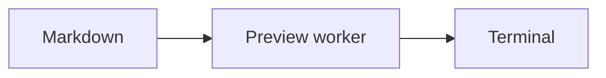
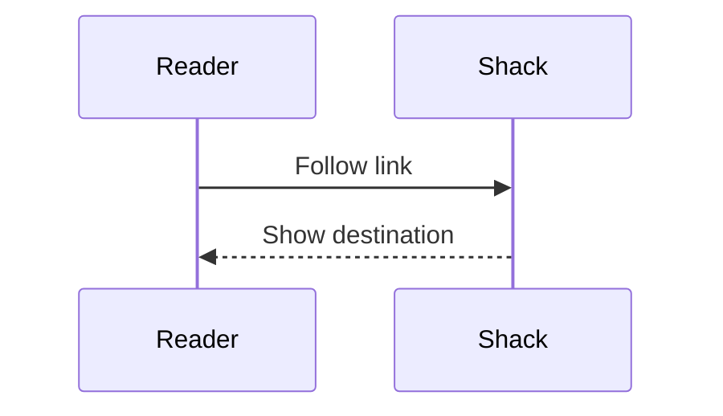

# Shack document preview

Press **F4** to toggle this source and its preview. In the preview, press **Tab**
to select a link, then **Enter** to follow it. Use **Alt+Left** to return.

[Jump to navigation](#navigation) · [Open the usage guide](../docs/USAGE.md#markdown-and-org-previews)

A footnote can be followed[^details], including a second reference[^details].

## Colored code

```go
package main

// Code stays literal, with colors from the built-in lexer.
func main() {
    println("Hello, Shack!", 42)
}
```

## Local image


Use **Toggle preview media** in the command palette to compare the rendered view
with text placeholders and Mermaid source.

## Flowchart



## Sequence diagram



## Navigation

Relative-file links resolve beside the Markdown source, including paths with spaces.
This [Go source file](../cmd/shack/main.go) opens as editable text. The
[gradient image](preview-gradient.png) opens as an image preview.

[^details]: Footnote definitions have return arrows for each reference.
